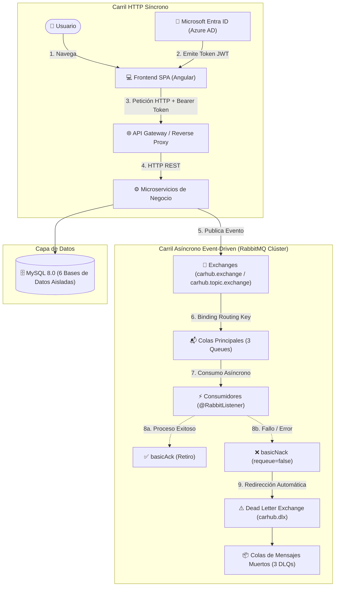

# 🚗 CarHub - Arquitectura Cloud Native

> **Evaluación EP4 · DSY1107 Desarrollo Cloud Native I · Duoc UC**  
> **Tema:** Arquitectura Cloud Native: API Gateway, Microservicios y Mensajería Resiliente con Clúster RabbitMQ  
> **Docente:** Jorge Niochet  
> **Integrantes:**  
> - Bruno Soto  
> - Bayron Fuentes  
> - Cristopher Candia  
> - Matias Reyes  

---

## 📌 1. Descripción del Proyecto

**CarHub** es una plataforma distribuida basada en arquitectura **Cloud Native** diseñada para la gestión, compra, soporte y cotización de vehículos y repuestos automotrices. 

El sistema implementa un modelo híbrido de comunicación:
1. **Carril Síncrono (HTTP REST / JSON):** Manejo de comandos y consultas inmediatas desde el frontend SPA hacia los microservicios, securizado mediante **Microsoft Entra ID (Azure AD)** con tokens **OAuth2 / JWT**.
2. **Carril Asíncrono (Event-Driven Messaging):** Desacoplamiento de procesos transaccionales críticos (emisión de tickets de compra, registro de reclamos de soporte y notificaciones) mediante un **Clúster de alta disponibilidad de RabbitMQ (2 nodos)** con colas durables, enrutamiento Direct/Topic y tolerancia a fallos mediante **Dead Letter Queues (DLQ)** y confirmación manual (**ACK / NACK**).

---

## 🏗️ 2. Arquitectura del Sistema



---

## 📦 3. Catálogo de Microservicios y Puertos

Cada microservicio es autónomo, posee su propio esquema de base de datos relacional y expone su documentación interactiva mediante Swagger / OpenAPI 3.

| Microservicio | Puerto | Base de Datos (MySQL) | Responsabilidad | Swagger UI |
| :--- | :---: | :---: | :--- | :--- |
| **`backend-automotriz`** | `8061` | `automotriz` | Gestión de concesionarias, talleres y sucursales. | [Swagger 8061](http://localhost:8061/swagger-ui/index.html) |
| **`backend-carhub-vehiculo`** | `8062` | `vehiculos` | Catálogo de vehículos, precios, marcas y modelos. | [Swagger 8062](http://localhost:8062/swagger-ui/index.html) |
| **`backend-piezas`** | `8063` | `piezas` | Inventario de repuestos y compatibilidad vehicular. | [Swagger 8063](http://localhost:8063/swagger-ui/index.html) |
| **`backend-reclamos`** | `8064` | `reclamos` | Tickets de soporte post-venta con RabbitMQ y DLQ. | [Swagger 8064](http://localhost:8064/swagger-ui/index.html) |
| **`backend-compra`** | `8065` | `compra` | Facturación y emisión asíncrona de tickets de venta. | [Swagger 8065](http://localhost:8065/swagger-ui/index.html) |
| **`backend-carhub`** | `8066` | `usuarios` | Autenticación Entra ID, usuarios y RabbitAdmin API. | [Swagger 8066](http://localhost:8066/swagger-ui/index.html) |

---

## 🐇 4. Topología de Mensajería RabbitMQ (Clúster de 2 Nodos)

El clúster está formado por dos nodos sincronizados:
* **Nodo 1 (Líder):** `rabbit@rabbit1` (AMQP `5672` | Panel Web `15672`)
* **Nodo 2 (Miembro):** `rabbit@rabbit2` (AMQP `5673` | Panel Web `15673`)
* **Credenciales de Gestión:** `guest` / `guest`

### Exchanges Configurados
* **`carhub.exchange` (Direct):** Enrutamiento punto a punto mediante coincidencia exacta de routing keys.
* **`carhub.topic.exchange` (Topic):** Enrutamiento flexible basado en patrones y comodines (`*.ticket.*`, `usuario.#`).
* **`carhub.dlx` (Direct - Dead Letter Exchange):** Intercambiador de respaldo que recibe mensajes rechazados o fallidos.

### Matriz de Colas, Bindings y DLQs

| Cola Principal | Exchange | Routing Key | Dead Letter Queue (DLQ) | DLQ Routing Key |
| :--- | :--- | :--- | :--- | :--- |
| **`backend-compra.ticket.queue`** | `carhub.exchange` | `backend-compra.ticket.rk` | `backend-compra.ticket.dlq` | `backend-compra.ticket.dlq.rk` |
| **`backend-reclamos.ticket.queue`** | `carhub.exchange` | `backend-reclamos.ticket.rk` | `backend-reclamos.ticket.dlq` | `backend-reclamos.ticket.dlq.rk` |
| **`backend-carhub.usuario.queue`** | `carhub.exchange` | `backend-carhub.usuario.rk` | `backend-carhub.usuario.dlq` | `backend-carhub.usuario.dlq.rk` |

### Política de Confirmación (ACK / NACK)
Todos los consumidores operan con confirmación manual explícita (`ackMode = "MANUAL"`):
* **`basicAck`:** Confirma el procesamiento exitoso del mensaje y lo libera de la cola.
* **`basicNack(..., requeue = false)`:** En caso de excepción de negocio o fallo de validación, rechaza el mensaje sin reencolarlo, forzando a RabbitMQ a derivarlo inmediatamente a la **DLQ** correspondiente.

---

## 🔐 5. Seguridad e Identidad (Microsoft Entra ID)

* **Proveedor de Identidad (IdP):** Microsoft Entra ID (Azure AD).
* **Protocolos:** OAuth 2.0 / OpenID Connect (OIDC).
* **Validación en Backend:** Spring Security Resource Server valida la firma criptográfica del JWT contra el endpoint público de claves de Microsoft (`https://login.microsoftonline.com/common/discovery/v2.0/keys`).
* **Validación de Claims:** Se verifican `issuer`, `exp` (caducidad) y `aud` (Audience / Client ID).

---

## 🚀 6. Despliegue Automatizado en Linux / AWS EC2

Toda la solución (Base de datos MySQL, Clúster RabbitMQ y los 6 microservicios Spring Boot) se despliega mediante un único script automatizado y Docker Compose con compilación multi-stage (no requiere tener Java ni Maven instalados en el servidor host).

### Requisitos Previos en el Servidor
* Docker Engine 24+
* Docker Compose v2+

### Ejecución del Despliegue
En la raíz del proyecto clonado en tu instancia EC2 o Linux:

```bash
# 1. Otorgar permisos de ejecución al script
chmod +x dockers/arrancar-servicios.sh

# 2. Ejecutar el orquestador
./dockers/arrancar-servicios.sh
```
*(Nota: Si tu usuario no pertenece al grupo docker, ejecútalo con `sudo ./dockers/arrancar-servicios.sh`).*

### ¿Qué hace el script automáticamente?
1. Limpia contenedores y redes residuales para evitar conflictos.
2. Detecta puertos en uso en el host.
3. Levanta **MySQL 8.0** y crea automáticamente las 6 bases de datos requeridas.
4. Levanta los nodos `rabbitmq1` y `rabbitmq2`, sincronizando el clúster.
5. Construye secuencialmente las imágenes Docker multi-stage optimizando el uso de memoria RAM (`-Xms128m -Xmx256m`) para entornos EC2.
6. Levanta todos los microservicios e imprime el resumen de salud y accesos.
7. Todos los contenedores cuentan con política `restart: always` para restaurarse automáticamente ante reinicios de la máquina virtual.

---

## 🧪 7. Pruebas de Demostración en Vivo

### A. Prueba de Autorización (HTTP 200 vs HTTP 401)
1. **Petición rechazada (401 Unauthorized):**
   * Petición: `GET http://<IP>:8066/api/v1/usuarios` sin cabeceras.
   * Respuesta esperada: `401 Unauthorized` con mensaje JSON explicativo.
2. **Petición aceptada (200 OK):**
   * Petición: `GET http://<IP>:8066/api/v1/usuarios`
   * Cabecera: `Authorization: Bearer <TOKEN_JWT_ENTRA_ID>`
   * Respuesta esperada: `200 OK` con listado JSON de usuarios.

### B. Prueba de Resiliencia RabbitMQ (Fallo controlado a la DLQ)
1. Ingresar al panel de RabbitMQ: `http://<IP>:15672` (usuario: `guest`, clave: `guest`).
2. Entrar a la cola `backend-compra.ticket.queue` $\rightarrow$ sección **Publish message**.
3. Enviar un payload vacío `{}` o mal formado.
4. El consumidor detecta los campos vacíos, genera una excepción y ejecuta `channel.basicNack(deliveryTag, false, false)`.
5. Comprobar que el mensaje sale de la cola principal y se almacena de inmediato en **`backend-compra.ticket.dlq`**.

---

## 📂 8. Estructura del Repositorio

```text
├── backend-automotriz/         # Microservicio Concesionarias y Sucursales (8061)
├── backend-carhub-vehiculo/    # Microservicio Catálogo de Vehículos (8062)
├── backend-piezas/             # Microservicio Repuestos y Piezas (8063)
├── backend-reclamos/           # Microservicio Reclamos de Soporte (8064)
├── backend-compra/             # Microservicio Compras y Facturación (8065)
├── backend-carhub/             # Microservicio Usuarios, OAuth2 y RabbitAdmin (8066)
├── frontend-carhub/            # Aplicación Web Frontend (Angular SPA)
├── dockers/                    # Infraestructura Docker, Scripts y Compose
│   ├── arrancar-servicios.sh   # Script de despliegue para Linux / AWS EC2
│   ├── arrancar-servicios.ps1  # Script de despliegue para Windows PowerShell
│   ├── docker-compose.yml      # Definición de servicios, redes y volúmenes
│   └── init-db.sql             # Inicialización de bases de datos MySQL
├── .gitattributes              # Normalización de saltos de línea LF para Linux
└── README.md                   # Documentación principal del proyecto
```
