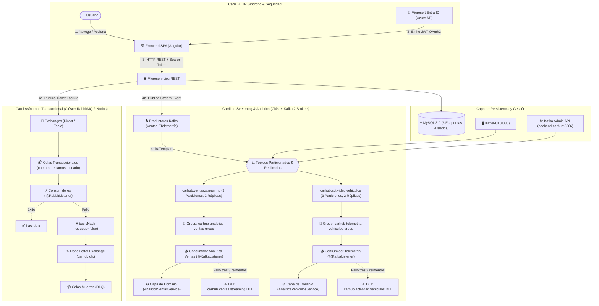

# 🚗 CarHub - Arquitectura Cloud Native

> **Evaluación Parcial N° 5 · DSY1107 Desarrollo Cloud Native I · Duoc UC**  
> **Tema:** Integración de Sistemas de Streaming y Analítica con Apache Kafka, Coexistencia Resiliente con Clúster RabbitMQ y Seguridad OAuth2 / Microsoft Entra ID  
> **Docente:** Jorge Niochet  
> **Integrantes:**  
> - Bruno Soto  
> - Bayron Fuentes  
> - Cristopher Candia  
> - Matias Reyes  

---

## 📌 1. Descripción del Proyecto

**CarHub** es una plataforma distribuida basada en arquitectura **Cloud Native** diseñada para la gestión, compra, soporte y cotización de vehículos y repuestos automotrices.

El sistema implementa un modelo de comunicación multicapa altamente resiliente y escalable:
1. **Carril Síncrono (HTTP REST / JSON):** Comunicación directa cliente-servidor desde el frontend SPA (Angular) hacia los microservicios, securizado mediante **Microsoft Entra ID (Azure AD)** con tokens **OAuth2 / JWT**.
2. **Carril Asíncrono Transaccional (RabbitMQ Clúster de 2 Nodos):** Desacoplamiento de procesos operacionales discretos punto a punto (emisión de tickets de compra y tickets de reclamos de soporte) con colas durables, confirmación manual explícita (**ACK / NACK**) y aislamiento de fallos mediante **Dead Letter Queues (DLQ)**.
3. **Carril Asíncrono de Streaming y Analítica (Apache Kafka Clúster de 2 Brokers):** Canal de procesamiento de eventos en tiempo real a gran escala para telemetría, demanda vehicular y analítica de ventas, con particionado balanceado, factor de replicación 2, políticas de retención temporal y grupos de consumidores dedicados (**Consumer Groups**).

---

## ⚖️ 2. Justificación del Diseño: Convivencia RabbitMQ vs Apache Kafka

| Criterio de Comparación | RabbitMQ (Mensajería Transaccional) 🐇 | Apache Kafka (Streaming y Analítica) ⚡ |
| :--- | :--- | :--- |
| **Patrón Principal** | Cola de mensajes de trabajo (Work Queues) y enrutamiento directo / tópicos transaccionales. | Registro inmutable de eventos distribuidos (Append-only Distributed Log). |
| **Caso de Uso en CarHub** | Emisión de facturas / tickets de compra y registro de tickets de soporte postventa. | Registro continuo de analítica de ventas en vivo y telemetría de interacción / demanda por vehículo. |
| **Ciclo de Vida del Mensaje** | El mensaje se elimina de la cola una vez confirmado con `basicAck`. | Los eventos persisten en el log según la política de retención configurada (ej. 3 a 7 días), permitiendo replay y múltiples consumidores. |
| **Manejo de Errores** | Confirmación manual con rechazo explícito `basicNack(requeue = false)` desviando a **Dead Letter Exchange (DLX)** y **DLQ**. | `DefaultErrorHandler` con reintentos (`FixedBackOff`), deserializador tolerante a fallos (`ErrorHandlingDeserializer`) y **Dead Letter Topic (DLT)**. |
| **Garantía y Escalabilidad** | Procesamiento unitario con alta fidelidad transaccional. | Alto rendimiento con particionamiento balanceado por clave (`partitionKey`) y balanceo de carga mediante **Consumer Groups**. |

---

## 🏗️ 3. Arquitectura Global del Sistema



---

## 📦 4. Matriz de Microservicios, Puertos y Roles de Mensajería

| Microservicio | Puerto Host | Base de Datos (MySQL) | Integración RabbitMQ 🐇 | Integración Apache Kafka ⚡ | Swagger / OpenAPI |
| :--- | :---: | :---: | :--- | :--- | :--- |
| **`backend-automotriz`** | `8061` | `automotriz` | *(Sin integración)* | *(Sin integración)* | [Swagger 8061](http://localhost:8061/swagger-ui/index.html) |
| **`backend-carhub-vehiculo`** | `8062` | `vehiculos` | *(Sin integración)* | **Productor:** Tópico `carhub.actividad.vehiculos` | [Swagger 8062](http://localhost:8062/swagger-ui/index.html) |
| **`backend-piezas`** | `8063` | `piezas` | *(Sin integración)* | *(Sin integración)* | [Swagger 8063](http://localhost:8063/swagger-ui/index.html) |
| **`backend-reclamos`** | `8064` | `reclamos` | **Productor/Consumidor:** Tickets con DLQ | *(Sin integración)* | [Swagger 8064](http://localhost:8064/swagger-ui/index.html) |
| **`backend-compra`** | `8065` | `compra` | **Productor/Consumidor:** Facturas con DLQ | **Productor:** Tópico `carhub.ventas.streaming` | [Swagger 8065](http://localhost:8065/swagger-ui/index.html) |
| **`backend-carhub`** | `8066` | `usuarios` | **Admin API** + Notificaciones con DLQ | **Admin API** + **Consumidor** de ambos tópicos | [Swagger 8066](http://localhost:8066/swagger-ui/index.html) |

---

## ⚡ 5. Topología de Apache Kafka (Clúster de 2 Brokers)

* **Zookeeper:** `zookeeper-carhub` (Puerto `2181`)
* **Kafka Broker 1 (Líder Clúster):** `kafka1-carhub` (Host: **`localhost:5030`** | Docker interno: `kafka1:29092`)
* **Kafka Broker 2 (Miembro Clúster):** `kafka2-carhub` (Host: **`localhost:5031`** | Docker interno: `kafka2:29093`)
* **Kafka-UI (Consola Web):** `kafka-ui-carhub` (Host: **`http://localhost:8085`**)

### Matriz de Tópicos de Negocio

| Tópico | Particiones | Replicación | Retención (`retention.ms`) | Cleanup Policy | Productor | Consumidor | Consumer Group | Propósito |
| :--- | :---: | :---: | :---: | :---: | :--- | :--- | :--- | :--- |
| **`carhub.ventas.streaming`** | `3` | `2` | 7 días (`604800000`) | `delete` | `backend-compra` | `backend-carhub` | `carhub-analytics-ventas-group` | Analítica continua de ingresos, ventas y perfil de compra en tiempo real. |
| **`carhub.actividad.vehiculos`** | `3` | `2` | 3 días (`259200000`) | `delete` | `backend-carhub-vehiculo` | `backend-carhub` | `carhub-telemetria-vehiculos-group` | Telemetría de demanda vehicular (vistas, cotizaciones, favoritos). |

### Resiliencia y Manejo de Errores en Kafka
* **ErrorHandlingDeserializer:** Envuelve al deserializador JSON para interceptar payloads corruptos o cadenas inesperadas sin abortar los hilos de escucha.
* **DefaultErrorHandler & FixedBackOff:** Ejecuta hasta **3 reintentos** automáticos espaciados por 1 segundo ante excepciones transitorias.
* **Logging Contextual:** Se registran el tópico, partición, offset, llave y mensaje de causa exacto en caso de error.
* **Separación de Capas:** Los consumidores `@KafkaListener` no implementan lógica de negocio; delegan directamente a servicios de dominio independientes (`AnaliticaVentasService` y `AnaliticaVehiculosService`).

---

## 🛠️ 6. Microservicio Administrador de Kafka (`backend-carhub`)

El microservicio expone endpoints REST construidos sobre la API oficial `AdminClient` de Apache Kafka:

| Método | Endpoint | Descripción |
| :--- | :--- | :--- |
| `POST` | `/api/v1/admin/kafka/topics` | Crea un nuevo tópico especificando nombre, particiones, réplicas, `retentionMs` y `cleanupPolicy`. |
| `GET` | `/api/v1/admin/kafka/topics` | Lista todos los tópicos del clúster con su cantidad de particiones y factor de replicación. |
| `GET` | `/api/v1/admin/kafka/topics/{name}` | Inspecciona detalle completo del tópico: réplicas, líderes y configuraciones avanzadas. |
| `PATCH` | `/api/v1/admin/kafka/topics/{name}` | Modifica particiones (incremento) o parámetros de configuración (`retention.ms`, `cleanup.policy`). |
| `DELETE` | `/api/v1/admin/kafka/topics/{name}` | Elimina un tópico del clúster. |
| `GET` | `/api/v1/admin/kafka/consumer-groups` | Lista todos los **Consumer Groups** registrados, su estado (`STABLE`), miembros y offsets. |
| `GET` | `/api/v1/admin/kafka/analytics/ventas` | Consulta las métricas agregadas obtenidas del flujo streaming de ventas. |
| `GET` | `/api/v1/admin/kafka/analytics/vehiculos` | Consulta el ranking de demanda e interacciones de vehículos en tiempo real. |

---

## 🖥️ 7. Script CLI de Infraestructura (`dockers/kafka-admin.sh`)

Para operaciones rápidas desde consola o pipelines:

```bash
# Otorgar permisos
chmod +x dockers/kafka-admin.sh

# Listar tópicos en el clúster
./dockers/kafka-admin.sh listar-topicos

# Ver detalle de particiones, réplicas y configs de un tópico
./dockers/kafka-admin.sh describir-topico carhub.ventas.streaming

# Crear un tópico personalizado (nombre, particiones, réplicas, retención ms)
./dockers/kafka-admin.sh crear-topico mi.nuevo.topico 3 2 86400000

# Listar Consumer Groups activos
./dockers/kafka-admin.sh listar-grupos

# Ver lag y miembros de un Consumer Group
./dockers/kafka-admin.sh describir-grupo carhub-analytics-ventas-group

# Consumir eventos en vivo desde el inicio
./dockers/kafka-admin.sh consumir carhub.ventas.streaming

# Verificar estado y brokers registrados en Zookeeper
./dockers/kafka-admin.sh estado-cluster
```

---

## 🚀 8. Despliegue Automatizado en Linux / AWS EC2

```bash
# En la raíz del repositorio:
chmod +x dockers/arrancar-servicios.sh
./dockers/arrancar-servicios.sh
```

El script se encarga de:
1. Limpiar contenedores previos de MySQL, RabbitMQ y Kafka.
2. Iniciar **MySQL 8.0** y crear los 6 esquemas de base de datos.
3. Iniciar los 2 nodos de **RabbitMQ** y sincronizar el clúster.
4. Iniciar **Zookeeper**, **Kafka Broker 1** (puerto `5030`), **Kafka Broker 2** (puerto `5031`) y **Kafka-UI** (puerto `8085`).
5. Compilar y levantar los 6 microservicios Spring Boot con variables de entorno para RabbitMQ y Kafka.

---

## 🧪 9. Pruebas de Demostración en Vivo para la Evaluación

### A. Verificar Clúster Kafka y Tópicos con Particiones / Réplicas
1. Abrir en el navegador: `http://localhost:8085` (Kafka-UI).
2. Comprobar que el clúster `carhub-cluster` tiene **2 brokers activos** (Broker 1 y Broker 2).
3. Inspeccionar los tópicos `carhub.ventas.streaming` y `carhub.actividad.vehiculos`:
   * Verificar **3 Particiones** por tópico.
   * Verificar **Factor de Replicación 2**.
   * Verificar en *Configurations* el parámetro `retention.ms` (604800000 y 259200000 respectivamente).

### B. Probar Producción y Consumo Streaming de Ventas (Convivencia RabbitMQ + Kafka)
1. Ejecutar una compra en `POST http://localhost:8065/api/v1/compras`:
   ```json
   {
     "idUser": 1,
     "idVehiculo": 10,
     "idAutomotriz": 2,
     "metodoPago": "TRANSFERENCIA",
     "subtotal": 18500000
   }
   ```
2. Verificar en la consola de `backend-compra`:
   * Emisión a RabbitMQ para el ticket transaccional.
   * Emisión asíncrona a Kafka hacia `carhub.ventas.streaming` con clave de partición.
3. Verificar en la consola de `backend-carhub`:
   * Consumo inmediato vía `@KafkaListener` en el grupo `carhub-analytics-ventas-group`.
   * Procesamiento en la capa de dominio `AnaliticaVentasService`.
4. Consultar métricas en tiempo real:
   * `GET http://localhost:8066/api/v1/admin/kafka/analytics/ventas`

### C. Probar Telemetría y Demanda de Vehículos
1. Consultar un vehículo en `GET http://localhost:8062/api/v1/vehiculos/1`.
2. `backend-carhub-vehiculo` emite el evento `'VISTO'` hacia `carhub.actividad.vehiculos`.
3. `backend-carhub` consume el evento en el grupo `carhub-telemetria-vehiculos-group`.
4. Consultar el ranking de demanda:
   * `GET http://localhost:8066/api/v1/admin/kafka/analytics/vehiculos`

### D. Probar Operaciones del Microservicio Administrador de Kafka
1. **Crear tópico:**
   * `POST http://localhost:8066/api/v1/admin/kafka/topics`
   * Body: `{"name": "carhub.telemetria.talleres", "partitions": 3, "replicationFactor": 2, "retentionMs": 86400000, "cleanupPolicy": "delete"}`
2. **Listar tópicos:**
   * `GET http://localhost:8066/api/v1/admin/kafka/topics`
3. **Modificar tópico (incrementar particiones):**
   * `PATCH http://localhost:8066/api/v1/admin/kafka/topics/carhub.telemetria.talleres`
   * Body: `{"partitions": 4}`
4. **Listar Consumer Groups:**
   * `GET http://localhost:8066/api/v1/admin/kafka/consumer-groups`
5. **Eliminar tópico:**
   * `DELETE http://localhost:8066/api/v1/admin/kafka/topics/carhub.telemetria.talleres`

---

## 📂 10. Estructura del Repositorio

```text
├── backend-automotriz/         # Microservicio Concesionarias y Sucursales (8061)
├── backend-carhub-vehiculo/    # Microservicio Vehículos y Productor Kafka Telemetría (8062)
├── backend-piezas/             # Microservicio Repuestos y Piezas (8063)
├── backend-reclamos/           # Microservicio Reclamos de Soporte con RabbitMQ y DLQ (8064)
├── backend-compra/             # Microservicio Compras, RabbitMQ DLQ y Productor Kafka Ventas (8065)
├── backend-carhub/             # Usuarios, OAuth2, RabbitAdmin, KafkaAdmin y Consumidores Kafka (8066)
├── frontend-carhub/            # Aplicación Web Frontend (Angular SPA)
├── dockers/                    # Infraestructura Docker, Scripts y Compose
│   ├── arrancar-servicios.sh   # Despliegue automatizado Linux / AWS EC2
│   ├── arrancar-servicios.ps1  # Despliegue automatizado Windows PowerShell
│   ├── kafka-admin.sh          # Utilidad CLI para inspección y gestión de Kafka
│   ├── docker-compose.yml      # Definición de MySQL, RabbitMQ Clúster, Kafka Clúster y Kafka-UI
│   └── init-db.sql             # Inicialización de bases de datos MySQL
├── puertos.txt                 # Catálogo oficial de puertos y servicios
├── .gitattributes              # Normalización de saltos de línea LF para Linux
└── README.md                   # Documentación principal del proyecto
```
